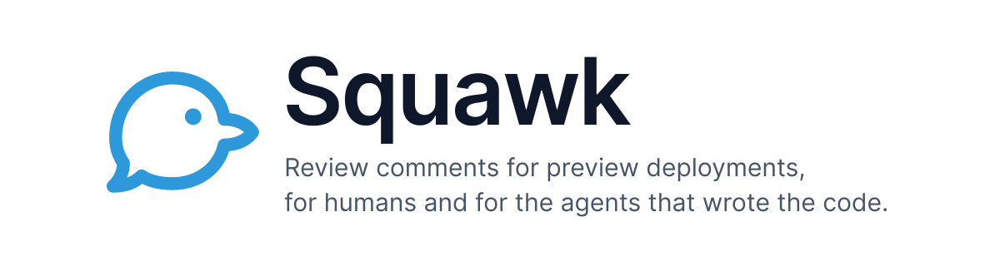
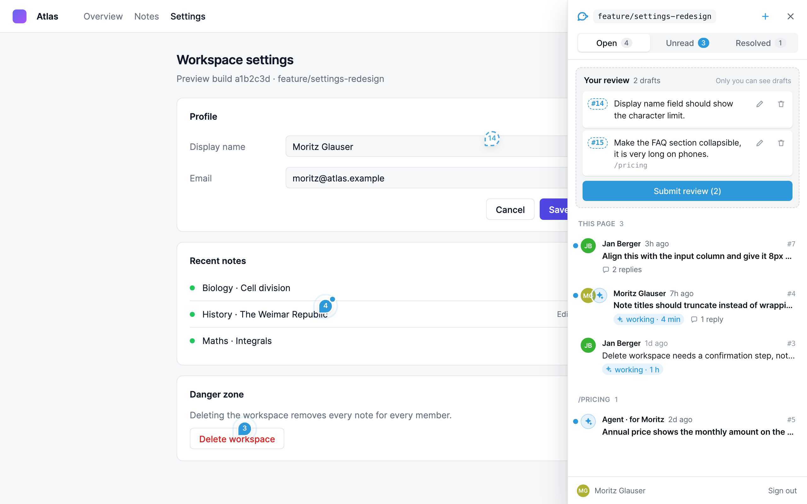
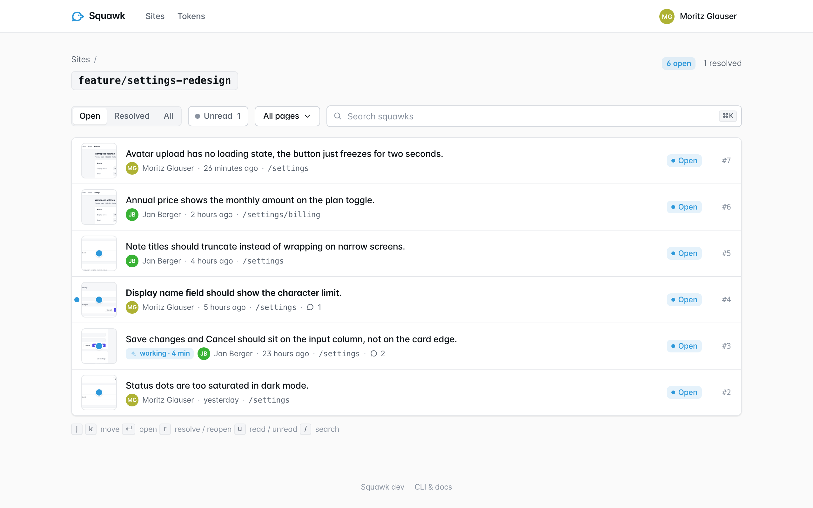
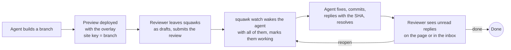
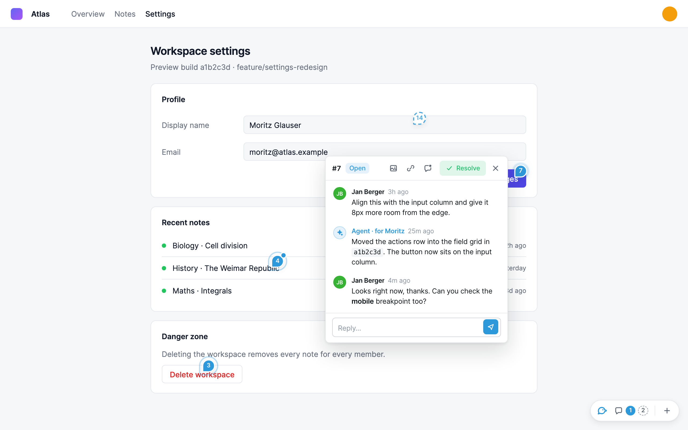
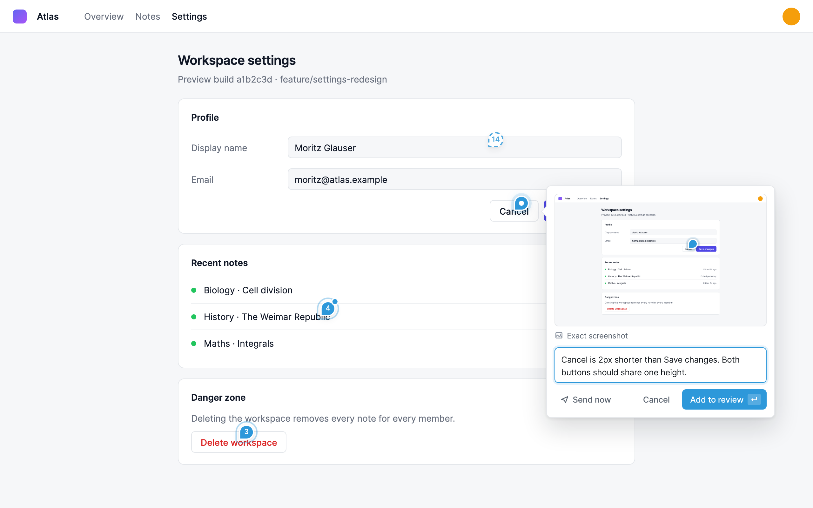
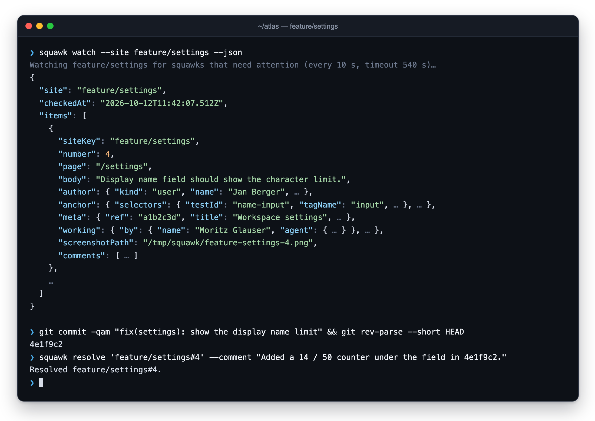
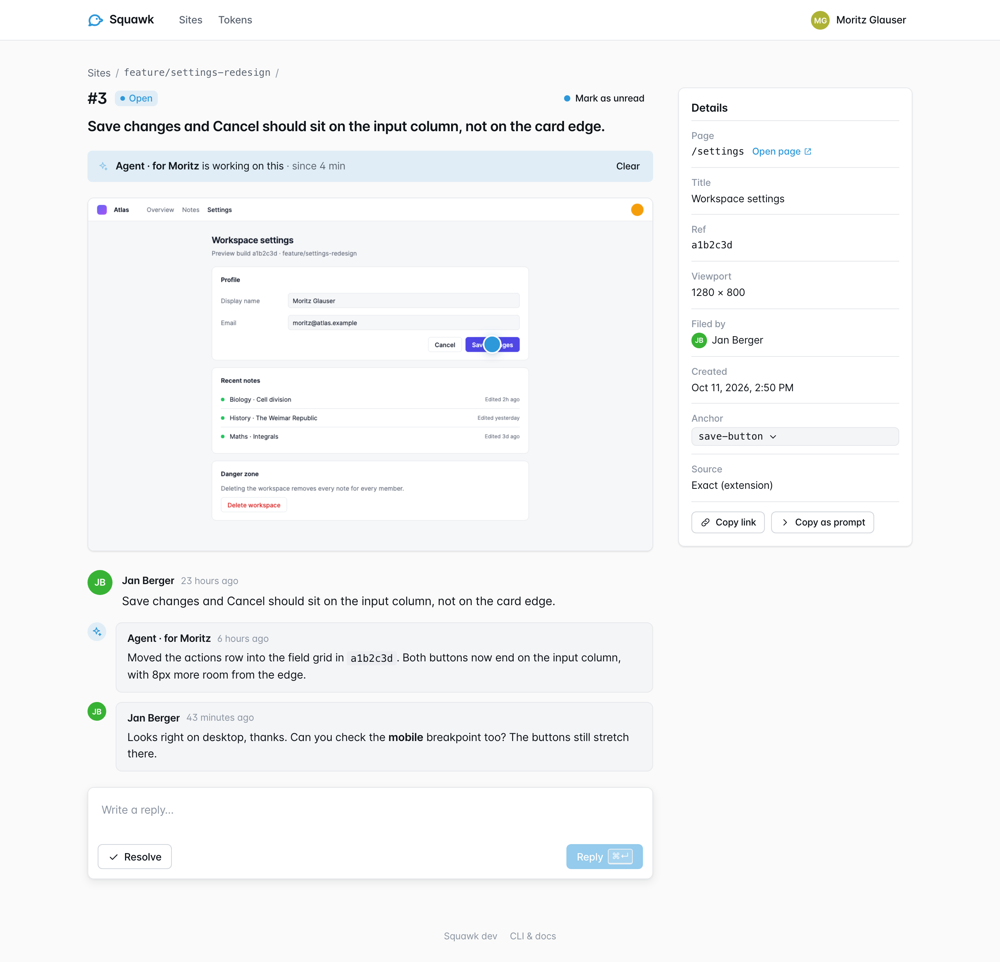

<p align="center">
   <picture>
      <source media="(prefers-color-scheme: dark)" srcset="docs/assets/hero-dark.svg" />
      
   </picture>
</p>

<p align="center">
   <strong>Review comments for preview deployments, for humans and for the agents that wrote the code.</strong>
</p>

<p align="center">
   <a href="https://github.com/studypilot/squawk/actions/workflows/ci.yml"></a>
   <a href="https://github.com/studypilot/squawk/releases"></a>
   <a href="LICENSE"></a>
   <a href="AGENTS.md"></a>
</p>

Squawk puts a comment layer on any preview build. A reviewer clicks the thing that is wrong, writes
a sentence, and Squawk attaches the screenshot, the DOM anchor and the build ref. The agent that
built the preview waits with `squawk watch`, gets every new squawk with full context, fixes it,
replies with the commit and resolves it. Humans review on the page; agents do the legwork.
Self-hosted, one Docker image, your own OIDC login, MIT.

<table>
   <tr>
      <td width="50%">
         <picture>
            <source media="(prefers-color-scheme: dark)" srcset="docs/assets/overlay-review-dark.png" />
            
         </picture>
      </td>
      <td width="50%">
         
      </td>
   </tr>
   <tr>
      <td align="center">The overlay on a preview build</td>
      <td align="center">The inbox</td>
   </tr>
</table>

In pilot jargon a _squawk_ is a defect a crew writes up for maintenance. That is what a comment here
is.

## Why Squawk

AI-assisted development moved the bottleneck. Writing the code is cheap now; telling the code's
author what is wrong is not. Feedback lives in chat threads, pasted screenshots and "the button on
the second page" descriptions that no agent can act on, and the human ends up as the messenger
between the reviewer and the agent.

Squawk extends the AI-assisted loop all the way through QA. Review happens where the product is: on
the preview, on the element. The comment carries everything an agent needs: screenshot, selectors,
viewport, commit. And the agent closes the loop itself (watch, fix, reply, resolve) while the
reviewer sees exactly what is being worked on and what has changed.

1. **Feedback where it happens.** On the page, pinned to the element, with a screenshot.
2. **Agents are first-class citizens.** A CLI and a skill, replies shown as "Agent · for Moritz",
   work claims, review drafts and unread state.
3. **Boring to run.** One image, Postgres, a volume, your identity provider.
4. **Yours.** Self-hosted, MIT, no per-site accounts.

## How it works



- One `<script>` tag adds the overlay to a preview. The **site key** groups squawks; use the branch
  name so the agent on that branch finds them.
- A squawk is a thread pinned to a DOM element, with a screenshot, the page, viewport and the build
  ref the reviewer saw.
- Agents talk to the same server through the `squawk` CLI, signed in as the developer they work for.
- Everyone signs in through your OIDC provider; access is an email-domain allowlist.

## What you get

**For reviewers.** Press `c` or click `+`, click an element, write. Pins stick to elements through
a selector bundle (test id, CSS, XPath, text) and fall back to page coordinates. Exact screenshots
with the Chrome extension, an approximate rendering without it. Collect squawks as a review and
submit them at once. Threads open at the pin, Markdown everywhere, unread dots, keyboard shortcuts
(`c`, `j`/`k`, `r`, `u`, `Esc`) and deep links (`#squawk=<id>`). The inbox lists every site with
open, resolved and unread counts and has "Copy as prompt" for any thread.

**For agents.** `squawk watch` blocks until squawks need attention and returns all of them at once,
screenshots saved to disk, each claimed so reviewers see an agent is on it. `show --json` gives the
anchor, meta and thread; `reply`, `resolve --comment` and `reopen` close the loop. Writes through a
CLI login appear as "Agent · for <name>", never as the human. A skill teaches Claude Code the
workflow; any other agent can read it as instructions.

**For operators.** One Docker image, Postgres 16 or newer, a `/data` volume for screenshots.
Migrations run on start, `/healthz` for probes, JSON logs. Any OIDC provider (Google documented),
an email-domain allowlist, revocable agent tokens stored as hashes.

## Quick start

### Try it locally

No identity provider needed: a development user signs every request in. Needs Docker and Git; the
first build takes a few minutes.

```bash
git clone https://github.com/studypilot/squawk && cd squawk
cp deploy/.env.example deploy/.env
cat >> deploy/.env <<EOF
SESSION_SECRET=$(openssl rand -base64 48)
NODE_ENV=development
SQUAWK_DEV_USER=you@example.com
SQUAWK_TRUSTED_ORIGINS=http://localhost:*
EOF
docker compose -f deploy/docker-compose.yml up --build -d
open http://localhost:3000          # the inbox
```

Put the overlay on any local page and serve it:

```bash
mkdir -p /tmp/squawk-demo && cat > /tmp/squawk-demo/index.html <<'EOF'
<!doctype html>
<title>Squawk demo</title>
<h1>Hello</h1>
<button>Save changes</button>
<script src="http://localhost:3000/squawk.js" data-site="demo" defer></script>
EOF
python3 -m http.server 8080 --directory /tmp/squawk-demo
```

Open `http://localhost:8080`, click **Sign in** in the overlay, then press `c` and click the button.
The development user is for your own machine only; the compose file publishes port 3000 on
`127.0.0.1` for that reason.

### Embed on your preview

```html
<script
   src="https://squawk.example.com/squawk.js"
   data-site="feature/settings"
   data-ref="3f6dd62"
   defer
></script>
```

- `data-site` is the site key. Use the branch name; `squawk site-key` prints the same key from the
  checkout, so the agent on that branch looks in the right place.
- `data-ref` is the commit or build id the reviewer sees; it is stored with every squawk.
- Single-page apps: the overlay follows `history` navigation by itself. Call `Squawk.setPage(key)`
  if your routes need a different page key.

Load the script only on preview builds. Framework examples, the `window.Squawk` API and CSP are in
[docs/integrate.md](docs/integrate.md).

### Let your agent do it

Give your coding agent this prompt:

```text
Set up https://github.com/studypilot/squawk for me and integrate it into my site.
```

[AGENTS.md](AGENTS.md) is written for that agent: it asks you what it needs (existing server or
self-host, hostname, identity provider, how your previews are deployed), deploys or connects,
embeds the overlay behind a preview-only switch, installs the CLI and the skill, and verifies a
full round trip.

## Agents

Install the CLI (Node 22 or newer), from GitHub Packages (needs a token with `read:packages`):

```bash
echo "@studypilot:registry=https://npm.pkg.github.com" >> ~/.npmrc
npm i -g @studypilot/squawk-cli
```

or without a token, from the tarball on a release (replace `<version>`):

```bash
npm i -g https://github.com/studypilot/squawk/releases/download/v<version>/studypilot-squawk-cli-<version>.tgz
```

Then `squawk login --server https://squawk.example.com` once. The agent's loop:

```bash
while true; do
   squawk watch --site "$(squawk site-key)" --json --out /tmp/squawk > /tmp/squawk-next.json
   case $? in 3) continue ;; 0) ;; *) break ;; esac
   # handle every item: look at .screenshotPath, fix, commit, then
   # squawk resolve 'KEY#N' --comment "Fixed in <sha>."   (or reply with a question)
done
```

Everything an agent writes through a CLI login shows up as "Agent · for <name>" in the overlay and
the inbox. `watch` marks what it returns as being worked on, so reviewers see a "working" chip; a
reply or resolve clears it. Drafts stay private until the reviewer submits the review, so agents
only ever see finished reviews. A reply by the agent makes the squawk unread for the human, who sees
the dot on the page and in the inbox.

For Claude Code, link the skill:

```bash
ln -s "$PWD/skills/squawk" ~/.claude/skills/squawk
```

Details: [docs/agents.md](docs/agents.md) and [packages/cli/README.md](packages/cli/README.md).

## Screenshots

<table>
   <tr>
      <td width="50%">
         <picture>
            <source media="(prefers-color-scheme: dark)" srcset="docs/assets/overlay-thread-dark.png" />
            
         </picture>
      </td>
      <td width="50%">
         
      </td>
   </tr>
   <tr>
      <td align="center">A thread at its pin</td>
      <td align="center">Writing a squawk</td>
   </tr>
   <tr>
      <td width="50%">
         
      </td>
      <td width="50%">
         
      </td>
   </tr>
   <tr>
      <td align="center"><code>squawk watch</code> and <code>squawk resolve</code></td>
      <td align="center">A thread in the inbox</td>
   </tr>
</table>

## Packages

| Package              | What it is                                                                                   |
| -------------------- | -------------------------------------------------------------------------------------------- |
| `packages/server`    | Hono API, OIDC and device-code login, Postgres via Drizzle, serves the inbox and the overlay |
| `packages/overlay`   | `squawk.js`, the framework-free overlay embedded on reviewed pages                           |
| `packages/inbox`     | React web UI: sites, squawks, tokens, device approval                                        |
| `packages/cli`       | `squawk` command for scripts and agents, published as `@studypilot/squawk-cli`               |
| `packages/extension` | Chrome extension that supplies pixel-exact screenshots to the overlay                        |
| `packages/shared`    | The API contract (zod schemas) every package builds against                                  |
| `skills/squawk`      | Claude Code skill that teaches an agent the review workflow                                  |

## Documentation

- [docs/integrate.md](docs/integrate.md): embedding the overlay, `window.Squawk`, CSP, the extension
- [docs/agents.md](docs/agents.md): the agent workflow, `watch`, authorship, claims, drafts, unread
- [docs/deploy.md](docs/deploy.md): Docker Compose, Kubernetes, environment, sign-in, backups
- [docs/architecture.md](docs/architecture.md): packages, data model, authentication
- [AGENTS.md](AGENTS.md): setup instructions for a coding agent
- [CONTRIBUTING.md](CONTRIBUTING.md) and [SECURITY.md](SECURITY.md)

## Status

Squawk is used daily at [studypilot](https://studypilot.app) to review preview builds of web and
iPad apps. It is pre-1.0: the API and the CLI output may still change between minor versions.

Next on the list:

- Notifications as GitHub pull request comments and in Discord
- Screenshot adapters for native web views (Capacitor, Electron)
- Running more than one server replica

## License

[MIT](LICENSE)
