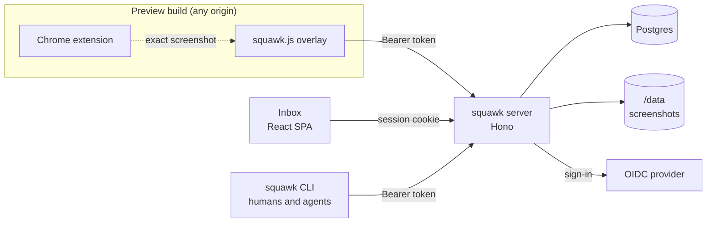
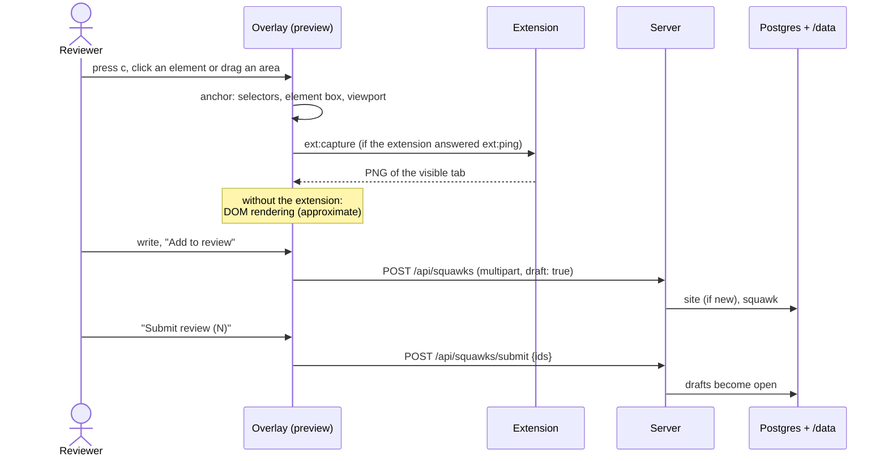
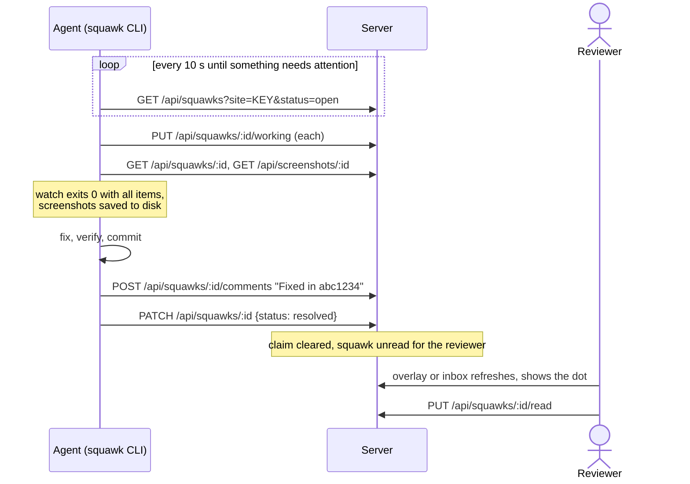

# Architecture

Squawk is one server with three clients. The server is a Hono app on Node 22 that owns the
Postgres database and the screenshot files, and serves the inbox and the overlay as static files.
All clients talk to the same JSON API under `/api`.

## Packages

| Package              | Role                                                                                                                     |
| -------------------- | ------------------------------------------------------------------------------------------------------------------------ |
| `packages/shared`    | The API contract: zod schemas for every request and response, limits and constants. Everything else builds against it.   |
| `packages/server`    | Hono API, OIDC sign-in, device-code and popup login, Drizzle on Postgres, migrations on start, static files.             |
| `packages/inbox`     | React + Vite. Sites, squawk threads, tokens, device approval and the `/connect` popup page. Built into the server image. |
| `packages/overlay`   | `squawk.js`, framework-free, Shadow DOM. Built as one IIFE into the server's public directory.                           |
| `packages/cli`       | `squawk`, a single bundled file with no runtime dependencies. Published as `@studypilot/squawk-cli`.                     |
| `packages/extension` | Manifest V3 Chrome extension; answers the overlay's capture requests with `chrome.tabs.captureVisibleTab`.               |
| `skills/squawk`      | The agent workflow as a Claude Code skill.                                                                               |

## Data model

| Table          | Holds                                                                                                                                                                                                                                                                                                                                            |
| -------------- | ------------------------------------------------------------------------------------------------------------------------------------------------------------------------------------------------------------------------------------------------------------------------------------------------------------------------------------------------ |
| `users`        | Everyone who signed in once: email, name, avatar. Created on first sign-in (or for the development user).                                                                                                                                                                                                                                        |
| `sites`        | Site keys, created implicitly by the first squawk or a site-restricted token. Optional display name.                                                                                                                                                                                                                                             |
| `squawks`      | Per-site numbered threads. `status` is `draft`, `open` or `resolved`. `page` key, `anchor` (selector bundle, element box, optional area, viewport, page coordinates) and `meta` (URL, title, viewport, `ref`, app version, extras) as JSON. Author and resolver as user and/or token. The working claim: user and/or token plus `working_since`. |
| `comments`     | The thread. The squawk's own text is its first comment; replies follow. Author as user and/or token.                                                                                                                                                                                                                                             |
| `screenshots`  | One per squawk: path relative to `DATA_DIR`, size, device pixel ratio, source `extension` or `dom`. The file lives at `screenshots/<yyyy>/<mm>/<uuid>.png`.                                                                                                                                                                                      |
| `tokens`       | Bearer tokens, stored as SHA-256 hashes with a display prefix. `kind` is `login` (acts as the user who approved it; `client` is `overlay` or `cli`) or `agent` (acts as an agent named by the token, created by a user, optionally restricted to one site). Expiry, revocation, last use.                                                        |
| `squawk_reads` | Per user and squawk: when the user last looked. Activity after that time makes the squawk unread for them.                                                                                                                                                                                                                                       |
| `device_codes` | Pending device-code logins, device code hashed. Deleted when the client collects its token.                                                                                                                                                                                                                                                      |

Authorship is stored as two nullable columns. Only a user: written in the overlay or the inbox.
Only a token: written by an agent token. Both: written by the user's agent through a CLI login
token; clients show it as "Agent · for <name>". Drafts are visible to their author only; every
other caller gets a 404 for them.

Migrations live in `packages/server/drizzle` and run inside the server before it listens.

## Authentication

- **Browser session (inbox).** `/auth/login` runs the OIDC authorization code flow against
  `OIDC_ISSUER` with scopes `openid email profile`. The callback requires `email_verified: true`,
  an email domain from `OIDC_ALLOWED_EMAIL_DOMAINS` and, if set, a matching `hd` claim. The session
  is a 12-hour HS256 JWT in the `squawk_session` cookie (`HttpOnly`, `SameSite=Lax`, `Secure` with
  an `https` `PUBLIC_URL`).
- **Popup login (overlay).** The overlay opens `<PUBLIC_URL>/connect?origin=<page origin>`. That
  page uses the session, asks for consent unless the origin matches `SQUAWK_TRUSTED_ORIGINS`, gets
  a 30-day login token (`client: overlay`) and posts it to its opener with the page origin as the
  target origin. The overlay accepts the message only from the server origin and from the popup it
  opened.
- **Device code (CLI, overlay fallback).** The client starts a login, shows a code, and polls; the
  user approves the code on `<PUBLIC_URL>/device` with their session. The client then receives a
  30-day login token (`client: cli` or `overlay`).
- **Bearer tokens.** `Authorization: Bearer sqk_…`. Login tokens act as their user; agent tokens act
  as themselves and cannot manage tokens. Site-restricted tokens see only their site; everything
  else looks like it does not exist.
- **CSRF.** Writes authenticated by the cookie must come from the server's own origin and carry a
  JSON body (or the multipart squawk upload). CORS on `/api` never allows credentials, so other
  origins can only use bearer tokens.
- **Development user.** `SQUAWK_DEV_USER` makes requests without credentials act as that user.
  The server refuses to start with it when `NODE_ENV=production`.

## Flows

### A reviewer leaves a squawk

"Send now" skips the draft and creates an open squawk directly.

### An agent handles it

The overlay polls the list every 5 seconds while its panel is open and every 60 seconds otherwise.
There is no push channel; everything is polling.

## Limits and operations

- Screenshots up to 8 MB (the overlay scales them to at most 2560 px wide first); comment bodies
  up to 10,000 characters.
- One server replica: device-login and popup-login rate limits live in memory, and the screenshot
  volume is usually `ReadWriteOnce`.
- `GET /healthz` checks the database and that `DATA_DIR` is writable.

See [deploy.md](deploy.md) for running it.

## History

[history/001-mvp.md](history/001-mvp.md) is the original design document the first version was
built from (in German). Parts of it are outdated; the code and these docs win.
